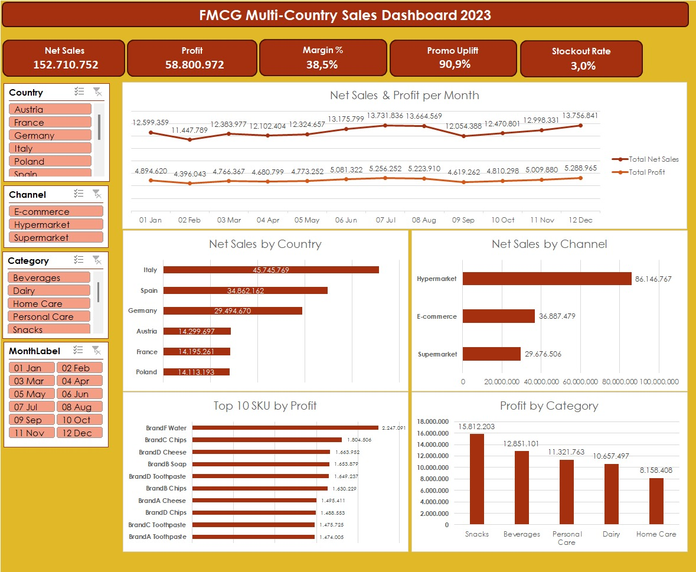
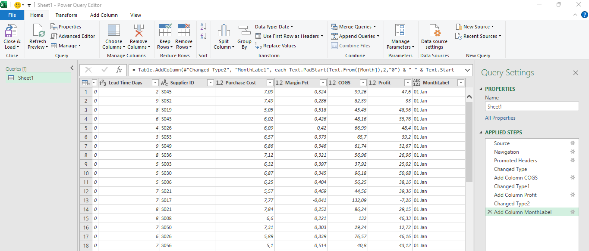
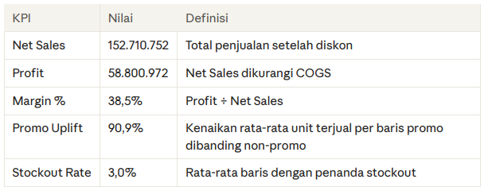
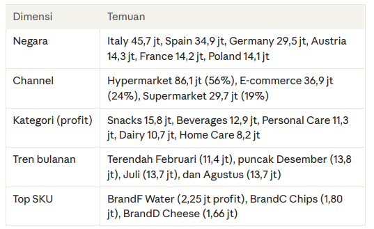
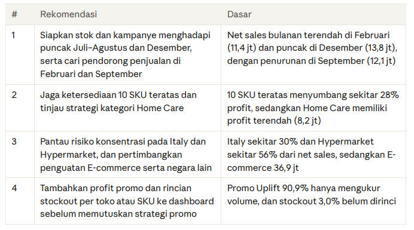
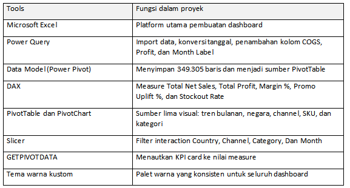

# Laporan Analisis: FMCG Multi-Country Sales Dashboard 2023 

Analisis penjualan 6 negara, 12 toko, dan 102 SKU (Januari–Desember 2023), dibangun dengan Excel.

---
## 1. Masalah

Perusahaan FMCG yang beroperasi di beberapa negara membutuhkan satu tampilan ringkas untuk memantau performa penjualan. Data mentah berisi 349.305 baris transaksi harian per SKU per toko, sehingga sulit dibaca tanpa diringkas dan divisualisasikan.

Pertanyaan bisnis yang dijawab:

* Berapa total penjualan dan profit, dan bagaimana polanya sepanjang tahun?
* Negara, channel, kategori, dan SKU mana yang paling berkontribusi?
* Seberapa besar promo menaikkan unit terjual?
* Apakah ada masalah ketersediaan stok (stockout)?

---
## Ringkasan Dataset

Dataset bersifat simulasi, sehingga temuan di bawah ditujukan untuk latihan analisis dan
bukan gambaran bisnis nyata.

---
## Power Query Excel

---
## 2. Analisis

Persiapan data. Kolom tanggal pada sumber berupa angka serial Excel (misalnya 44927), lalu dikonversi menjadi tanggal di Power Query. Tiga kolom turunan ditambahkan: COGS (Units Sold × Purchase Cost), Profit (Net Sales − COGS), dan Month Label untuk mengurutkan bulan. Data kemudian dimuat ke Data Model dan dihitung dengan DAX.

---
## KPI Utama

---
## Hasil Dimensi (Chart)

---
## 3. Insight

1. Penjualan terkonsentrasi pada beberapa segmen. Italy menyumbang 45,7 jt (sekitar 30% net sales) dan tiga negara teratas (Italy, Spain, Germany) sekitar 72%. Hypermarket menyumbang 86,1 jt (sekitar 56%), E-commerce 36,9 jt, dan Supermarket 29,7 jt.
2. Penjualan bulanan relatif stabil, dengan puncak di pertengahan dan akhir tahun. Net sales bulanan berkisar 11,4–13,8 jt: terendah Februari (11,4 jt), puncak Desember (13,8 jt), Juli dan Agustus (13,7 jt), dengan penurunan di September (12,1 jt).
3. Profit mengikuti pola penjualan dengan margin yang stabil. Profit bulanan berkisar 4,4–5,3 jt dan margin bulanan berada di kisaran 38–39%, sejalan dengan margin tahunan 38,5%.
4. Snacks adalah kategori dengan profit terbesar. Snacks menghasilkan 15,8 jt (sekitar 27% total profit), sedangkan Home Care terkecil dengan 8,2 jt (sekitar 14%).
5. Profit terkonsentrasi pada SKU teratas. BrandF Water memimpin dengan 2,25 jt, dan 10 SKU teratas menyumbang sekitar 16,6 jt atau 28% total profit dari 102 SKU.
6. Promo dan stok baru terlihat dari sisi volume. Promo Uplift 90,9% menunjukkan rata-rata unit terjual per baris promo hampir dua kali lipat baris non-promo, dan stockout rate 3,0%. Dashboard belum menampilkan dampak promo terhadap profit maupun rincian stockout, sehingga keduanya belum bisa disimpulkan lebih jauh.

---
## 4. Rekomendasi

---
## 5. Tools

