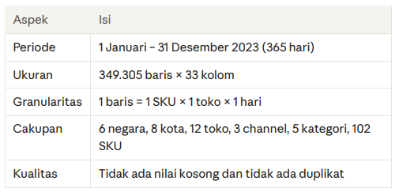

# Laporan Analisis: FMCG Multi-Country Sales Dashboard 2023 

Analisis penjualan 6 negara, 12 toko, dan 102 SKU (Januari–Desember 2023), dibangun dengan Excel.
---

## 1. Masalah

Perusahaan FMCG yang beroperasi di beberapa negara membutuhkan satu tampilan ringkas untuk memantau performa penjualan. Data mentah berisi 349.305 baris transaksi harian per SKU per toko, sehingga sulit dibaca tanpa diringkas dan divisualisasikan.

Pertanyaan bisnis yang dijawab:

* Berapa total penjualan dan profit, dan bagaimana polanya sepanjang tahun?
* Negara, channel, kategori, dan SKU mana yang paling berkontribusi?
* Seberapa besar promo menaikkan unit terjual?
* Apakah ada masalah ketersediaan stok (stockout)?

---

## Ringkasan Dataset



```


---

## Temuan Utama (Key Insights)

Berdasarkan hasil eksekusi query di Google BigQuery, diperoleh temuan penting berikut:  

1. Paradoks Kurir Premium (SLA Jebol):
   * Opsi pengiriman First Class yang berbiaya mahal justru mencatat rekor keterlambatan terburuk mencapai 95,80% dengan rata-rata delay 1 hari.
   * Sebaliknya, layanan murah Standard Class operasionalnya jauh lebih terkendali dengan tingkat keterlambatan 38,50% dan deviasi waktu mendekati nol (0,01 hari).
2. Kebocoran Profit Konstan:
   * Di semua jenis kurir, perusahaan konsisten kehilangan sekitar 10% hingga 10,8% dari total omzet akibat masalah operasional pengiriman. Layanan Second Class menjadi penyumbang persentase kerugian tertinggi (10,85%).
3. Kategori Produk Rentan (High-Risk):
   * Kategori produk Fishing memimpin kebocoran biaya terbesar senilai $728.570,95, disusul oleh Cleats ($452.594,21), dan Camping & Hiking ($443.082,23).

---

## Rekomendasi Strategis (Strategic Recommendation)

Sebagai Data Analyst, rekomendasi bisnis yang saya ajukan kepada manajemen adalah:  
1. Audit dan Evaluasi Vendor Logistik (3PL): Segera tinjau kembali kontrak kerja sama dengan pihak ketiga penyedia kurir First Class dan Second Class. Angka keterlambatan di atas 75% sudah melanggar komitmen janji layanan (SLA Breach), sehingga perlu diterapkan klausul pinalti finansial.
2. Rombak Opsi Pengiriman Premium: Tangguhkan sementara garansi waktu instan pada opsi First Class. Lebih baik alihkan volume pengiriman ke Standard Class yang terbukti jauh lebih stabil guna menekan klaim pengembalian dana dari pelanggan.
3. Jalur Khusus (Priority Lane) Produk Hobi: Berikan perhatian ekstra pada proses fulfillment dan packing untuk kategori produk Fishing dan Cleats di area gudang agar memperkecil peluang pembatalan pesanan akibat penanganan yang terlalu lama.

---

## Skills Demonstrated

* **Data Cleaning & Validation:** Melakukan standardisasi teks menggunakan `TRIM`, menangani nilai kosong dengan `COALESCE`, serta mengonversi nilai kerugian menjadi absolut (`ABS`) untuk memastikan laporan keuangan 100% valid sebelum dianalisis.
* **Advanced SQL Framework:** Mahir menulis query yang bersih dan efisien dengan memanfaatkan *Common Table Expressions* (CTEs), fungsi agregasi (`SUM`, `AVG`), pembulatan desimal (`ROUND`), serta pengelompokan data yang kompleks (`GROUP BY`).
* **Business Acumen & Cost Control:** Mampu menerjemahkan data mentah operasional logistik menjadi metrik finansial strategis yang dipahami oleh manajemen, salah satunya metrik *Loss to Sales Ratio* untuk mendeteksi kebocoran profit.
* **Logistics SLA Analytics:** Mampu melakukan audit performa ketepatan waktu pengiriman kurir dan mendeteksi anomali/paradoks antara janji layanan logistik premium dengan fakta di lapangan.

---

## Tools Used

* **Google BigQuery (SQL Engine):** Berperan sebagai *Cloud Data Warehouse* utama untuk menyimpan, membersihkan, mengagregasi, dan memproses dataset operasional berskala besar dengan performa tinggi.
